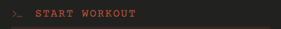

# List entry

## Why it is shaped this way

The entry glyph marks an entry the way a terminal prompt does, without ranking it as a number would.

## Purpose

One destination in a list.

## Rules

- The glyph, then the destination's name.

## Controls

| Tap | Does |
|---|---|
| The entry | Opens its screen |

## Images

Rendered from `component.html`.

