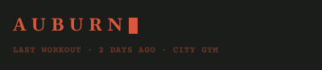

# Header

## Why it is shaped this way

AUBURN with a blinking cursor reads as a terminal waiting for input, which is what home is. The status line under it says where training last stood.

## Purpose

Names the app, and says when and where the last workout was.

## Rules

- The cursor blinks at the cursor-blink duration.
- The status is one line, given by the screen.

## Controls

None.

## Images

Rendered from `component.html`.

