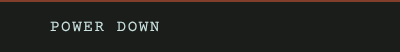
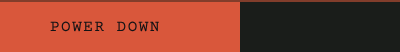

# Hold key

## Why it is shaped this way

An action that cannot be taken back is pressed and held. The fill shows how far the hold has come, and each letter inverts as the fill reaches it, so the key reads as committed before it is.

## Purpose

Takes an action that cannot be taken back, only when held to the end.

## Rules

- Held, the fill grows from the left over the hold-fill duration; let go before it is full, and it drains over the hold-drain duration and nothing happens.
- `fill` is how far the hold has come; `inverted` is how many letters the fill has reached.

## Controls

| Press | Does |
|---|---|
| Press and hold to the end | Takes the key's action, which is the screen's |

## Images

Rendered from `component.html`.

 
