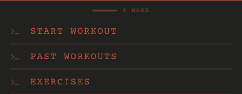
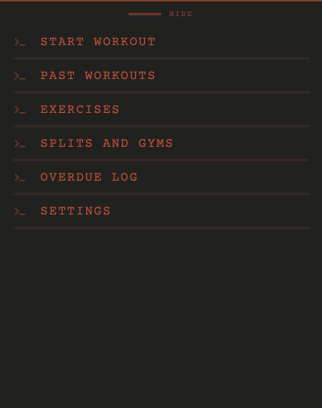

# List sheet

## Why it is shaped this way

The list slides over the screen's content, so the content keeps the room it needs and the list stays one gesture away. Its handle says what raising it gives.

## Purpose

Holds a list of destinations over the screen's content.

## Rules

- Down, it shows the entries that fit; raised, all of them. Where it sits in each position is the screen's.
- The handle's label is given by the screen: how many more entries there are while down, HIDE while raised.
- Its entries are list entries, in the order the screen gives.

## Controls

| Tap | Does |
|---|---|
| The handle, tap or drag | Raises or lowers it |

## Images

Rendered from `component.html`.

 
