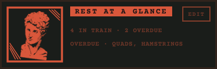
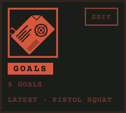
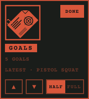
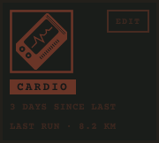

# Widget

## Why it is shaped this way

Rest at a glance, Goals and Cardio are the three things read at a glance on home, so each became a widget that also leads to its screen. A widget carries a cover the user knows by sight, its name on an accent band, and two lines of information. Every widget has its own EDIT key, because home's arrangement is the user's to set. While one widget is edited, the others step back, so only one thing is being changed at a time.

## Purpose

Shows one area of training at a glance, and leads to its screen.

## Rules

- `kind` sets the cover and the screen the widget opens: rest, goals or cardio.
- `width`: at full width the widget takes a row, its cover beside its text; at half width it shares a row, its cover above.
- `state`: idle; editing, with DONE in place of EDIT and its controls shown; stepped back, while another widget is edited.
- Each line of information is one line; a longer one ends in an ellipsis. What the lines carry is the screen's.

## Controls

| Tap | Does |
|---|---|
| The widget | Opens its screen |
| EDIT | Opens its controls; the other widgets step back |
| ▲ and ▼ | Move it one place in reading order |
| HALF and FULL | Set its width |
| DONE | Closes its controls |

## Images

Rendered from `component.html`.

   
