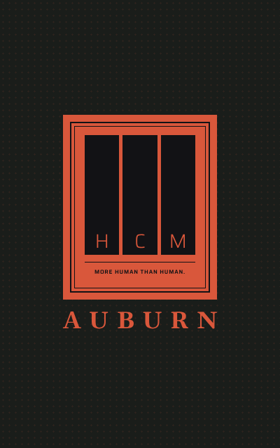
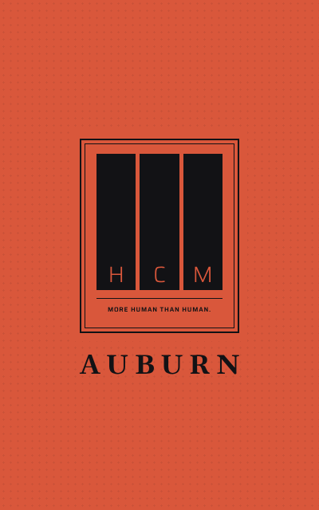

# 00 · Boot

## Why it is shaped this way

Auburn takes a moment to start. The boot fills that moment with the one thing no other screen shows: the brand, whole. It costs eight seconds only when Auburn starts cold, and never stands between the user and a workout in progress.

The mark is three pillars lettered H, C and M, for the three kinds of training Foundation names — hypertrophy, cardio, mobility — cut from an Ember plate inside a double rule. Six rounds on the canvas went from framed, unequal, and clipped pillars back to equal pillars in a framed plate, lettered at their feet, because the three kinds stand side by side and none outranks another.

The line under the mark changes each boot and never repeats twice running, so the boot stays worth watching. Lines are capped at 26 characters to fit the mark on one row.

The boot is the one screen that ignores taps and plays to the end: a skipped boot would show a half-drawn screen. It is also the one screen with a light theme in v1, because a brand moment can afford it where the working screens keep one look.

Its glass is High, not the basics' Low: in the Lab, Low was barely visible on the boot's large flat plate.

## Purpose

Shows Auburn's mark, its name, and a line for the moment the app takes to start, then fades into the first screen.

## Earns its place

It costs about eight seconds a few times a day and nothing more. It plays only when Auburn starts cold — never when it returns from the background, and never while a workout is in progress, when Auburn opens straight to the workout. It is the one place the brand is shown whole.

## Rules

- The line under the mark is one of nine, picked at random each boot and never the same twice running: "More human than human.", "Introducing, the new You.", "Human, improved.", "Built better. By you.", "Engineered to endure.", "Strength is a protocol.", "Advancement is mandatory.", "Obsolescence is optional.", "Flesh: the first machine." A line is at most 26 characters.
- The boot has both themes; the theme decides which version plays.

## Controls

None. The boot ignores taps and plays to the end.

## Images

Rendered from `screen.html`.

 
