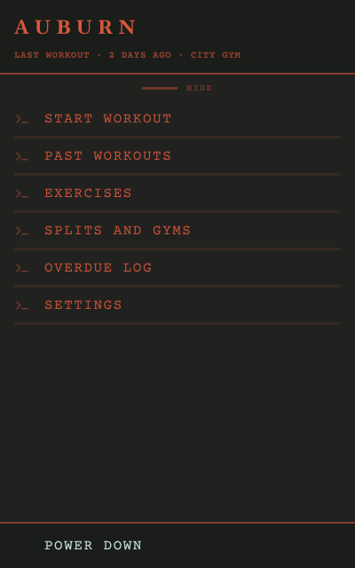
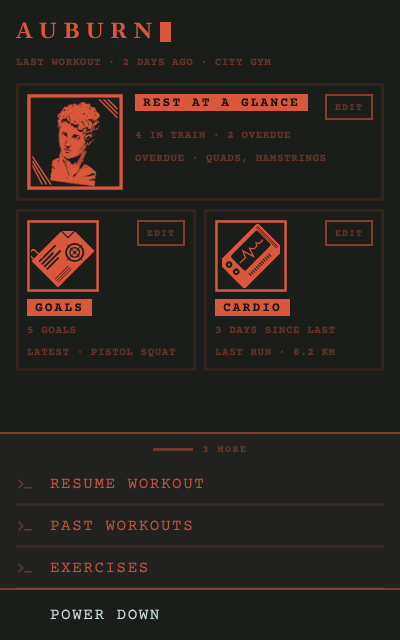
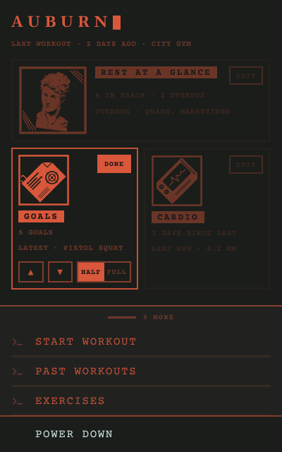
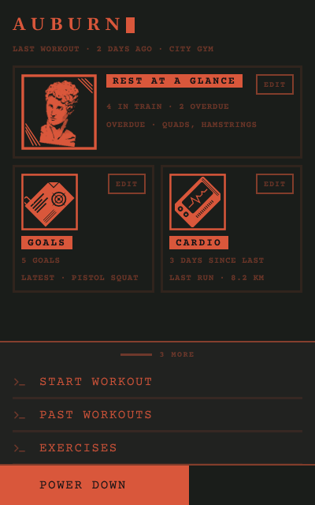

# 01 · Navigation

## Why it is shaped this way

Every screen has to be reached from somewhere, and the gym floor needs one predictable way. Three shapes were drawn: a bottom bar, which cannot hold nine destinations and is the market's default rather than a terminal's; a single menu key over rest at a glance; and a main menu as home, in the way retro interfaces behaved. The main menu won.

The information was settled on a wireframe before the screen was designed again. What remained:

- **The brand stays.** AUBURN with its cursor is always on home; its place is reserved.
- **One status line: the last workout.** Overdue groups are already asked about by the overdue prompt, a workout in progress already shows as RESUME WORKOUT, and the date adds nothing. All three were dropped.
- **Rest at a glance, Goals and Cardio became widgets.** These are the three things read at a glance, and each still leads to its screen. Their order and width are the user's, because what matters most is the user's to say. The tinted figure stays on the rest screen; on home, the counts are enough.
- **The list slides.** Showing three entries and raising the rest frees the space the widgets need, and gives the screen depth: content, then the list over it, then power down over both.
- **The entry glyph replaced the numbers.** Numbers repeated each entry's position and carried nothing else; a terminal prompt marks an entry without ranking it.
- **Power down is pressed and held.** It cannot be taken back, so it asks for a deliberate act. It stays at the bottom edge on its own layer, always visible.

The covers borrow from terminal icons — a solid object turned inside a heavy frame — and Rest's cover is a traced classical bust, the body Auburn keeps rest for. A cover's name band is dropped on widgets, where the name sits beside it on its own Ember fill.

The emphasis levels, Graphite, and Courier Prime were tuned on this screen first and became basics with it.

## Purpose

Home: shows where training stands at a glance and leads to every other screen.

## Earns its place

Every screen is reached from here, by one tap on a widget or an entry, so there is one predictable way around. It is not folded into rest at a glance, because it also carries goals, cardio, the list and power down.

## Opening Auburn

A cold start plays the boot and then shows home; with a workout in progress there is no boot, and Auburn opens straight to the workout. Returning from the background shows wherever Auburn was left. When an overdue answer is owed, the prompt opens over home. Android's back gesture on home sends Auburn to the background.

## Contents

Three layers: the content, the list over it, and Power down over both. Top to bottom:

- **AUBURN**, in Gelasio 700, with an Ember cursor blinking once every 1.1 s, always on home.
- **The status**: the last workout, when and where — "LAST WORKOUT · 2 DAYS AGO · CITY GYM" — at the secondary level.
- **The widgets**, in the order and widths the user sets; a full-width widget takes a row and half-width widgets pair up, in reading order. They start as Rest at a glance at full width, then Goals and Cardio at half width. Each has its cover — 96 at full width, 72 at half — its name on an Ember fill in Obsidian, its information at the secondary level, and an EDIT key. The area scrolls under the list.

  | Widget | Information |
  |---|---|
  | Rest at a glance | How many groups are in Train and Overdue; which groups are overdue |
  | Goals | How many goals; the latest progress |
  | Cardio | Days since the last activity; the last run |

- **The list**, on Graphite, edged at the secondary level: a handle reading "3 MORE" or "HIDE", then the entries, each with the entry glyph — Start workout (Resume workout while one is in progress), Past workouts, Exercises, Splits and gyms, Overdue log, Settings. Down, it shows the first three; raised, it rises to just below the status.
- **Power down**, fixed at the bottom edge on Tube, in Cyan White, always visible.

## Controls

| Tap | Does |
|---|---|
| A widget | Opens its screen: Rest at a glance, Goals, Cardio |
| EDIT | Opens the widget's controls: ▲ and ▼ move it one place in reading order, HALF and FULL set its width, DONE closes them. The other widgets step back to 42% |
| The list's handle, tap or drag | Raises or lowers the list |
| An entry | Opens its screen |
| Power down, press and hold | Plays the power-down, then Auburn quits |

Every key's tap area is at least 44 px.

## Images

    
